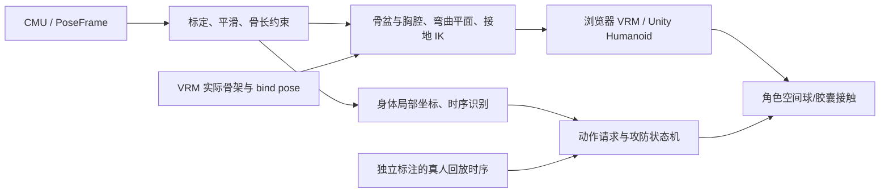

# Motion Lab v0.8：三回合排练、短步与动态皮套

## v0.8 当前默认与复现

旧步法把不同采集段的米级位移直接拼接，并把行走速度拉满整段；回收时脚接地阈值又导致骨盆高度跳变。当前 `sparring.py` 以绝对格斗站位编排 3×30 秒、两路独立姿态，短段真实步态配合步幅 IK，完成一步后站稳；接地垂直误差连续加权、限速与低通。真人髋肩运动保留，非刚体整体转圈。

实际重建皮套比例下，两人间距 0.679–1.8 m；90 秒未触发分离裁剪，根平面单帧位移最大 26.79 mm。双方平面纵向移动范围约 0.58 m，横向 0.27/0.29 m。估计支撑脚速度 P95 0.0141 m/s；这仍是算法接地标记上的自检，不能当成真人脚滑误差真值。7 次命中、7 次格挡、8 次挥空、10 次后摇阻止提交；每回合重置血量。完整参数和模型 SHA 在 `data/avatars/experiments/sparring-v08-20261024.json`。

```powershell
uv run --locked python tools/evaluate_sparring.py --output data/avatars/experiments/sparring-v08-20261024.json
node tools/evaluate_garment.mjs
```

第一条同时生成忽略目录 `outputs/sparring-latest.json` 并预热回放缓存。缓存只适用于公开排练，按配置、骨架比例、所有 Python 算法源文件与动捕样本内容校验；原子写入。实时相机/上传输入不读取这个缓存，衣物和渲染仍逐帧运行。首次计算 90 秒双人序列约需一分钟，同配置后续加载复用结果。

拳击参考攻击窗口从离线伸展峰值标注，踢腿沿用独立参考时序；二者仅驱动排练攻防，不进入因果动作识别器，不是识别准确率真值。当前没有完整受击反应动画，也不是任意动作的在线控制器。`cmu_footwork` 在菜单中明确保留为旧版无约束对照。

主界面一键录制完整三个画面，保持画面比例和可读血量/距离。默认专注演示，参数面板可展开。后面的 v0.7 数字和说明是历史基线，不再描述默认三回合。

### 当前设备的实测范围

RTX 4060 Laptop / Chrome 155，887×815 浏览器视口、三个可见视图、每帧约 95.3 万三角形，12 秒动画占比 100%：当前固定步长版本约 47.6 FPS、RAF P95 36.6 ms，衣发 CPU P95 16.8 ms。早期重复分配的实现同类场景约 29.2 FPS。两次是开发过程中的运行记录，不是隔离所有变量的严谨基准；当前也**未达到稳定 60 FPS**。模型与纹理没有降精度。后续优先将 PBD 转移到 Worker/WASM 并减少场景矩阵重复更新，再在最终设备上测摄像头到屏幕延迟。参考 `data/avatars/experiments/sparring-performance-v08-20261024.json`；录像编码的额外开销不包括在该 12 秒报告中。

## v0.7 历史步法基线


v0.7 默认展示两份本地绑定 Tripo 模型的头部/肤色重建版和真人步法组合；保留原网格贴图版本用于对照。新增 CMU 08_04 前进、76_09 后退、69_42 侧移，以及 76_01「后退后出拳」连续采集。反向侧移由真实步态左右镜像并交换左右关节得到，界面明确标注；后退不是前进倒放。

步法组合保留固定场地朝向，不把出拳末帧的髋部扭转累积为下一段走路方向。连接仍使用 C1 惯性衰减、速度与支撑匹配、脚 IK，并非在线 Motion Matching。单独的 76_01 可用于对照算法拼接与真实连续动作。起始间距 3.2 m 的默认组合避免双方站位挤压；其他片段/间距触发有序站位限制时仍会滑步，UI 如实标记。

过去所有输入都限制在相机前后 ±0.65 m，长动捕很快到边界。现在相机/导入数据保留安全站位与倍率，CMU 回放使用按皮套比例求解后的根位移，不再裁剪、再次低通或放大；在未发生两人分离限制时，场景移动与接地脚步一致。

渲染优化保留网格面数：GPU 四权重蒙皮，216 点裙布控制网格，避免逐骨递归更新所有后代；复用插值四元数；材质状态变化才更新；只更新可见视图所需角色；骨骼位置审计 5 Hz；授权裙布多个材质只计算一次法线。默认实时衣发只读取当前姿态与历史，最多两个物理更新步，拖动重置。缓存模式保留用于可重复关键帧检查。

“三屏同测”把主画面与两玩家视窗同时放在当前视口，12 秒测量从动作开头播放，输出 RAF P50/P95、CPU 姿态/衣发/提交成本、三角面与 draw call。性能开关只比较可见视图/骨架调度与审计频率，不能将它称为全部优化相对 v0.6 的端到端 A/B。GPU 执行时间未计时，摄像头采集、姿态估计、传输、显示扫描延迟未计入。最终硬件需重新测量。

实际接相机时应保持采集/识别与渲染解耦：约 30 Hz 更新骨架、识别使用捕获时间戳，渲染读取最新完整姿态并插值；丢帧不排队积累旧动作。60 FPS 的渲染预算为 16.7 ms，但不是识别时延预算。先测 Gemini 的姿态估计成本再决定是否需要 GPU 推理或专用线程，不通过减模替代性能定位。

按当前皮套骨长，默认 17.23 s 步法组合的根位移范围为横向 1.985 m、前后 1.235 m；518 帧中站位裁剪与双人挤压修正均为 0。估计支撑帧脚踝速度 P50 为 0、P95 为 0.124 m/s，仍存在脚滑；这些接地标记由算法估计，不能当作独立真值或完美接地证明。[可复查记录](../data/avatars/experiments/local-rig-pipeline-20261024.json) 同时固定资产 hash，可用下列命令重跑：

```powershell
uv run --locked python tools/evaluate_local_rig_motion.py
```

2026-10-24 本机 RTX 4060 Laptop 8 GB，1280×720 网页，像素倍率 1.5，同时显示三个视窗，实时衣发、同一原网格组合连续播放 12 秒：

| 调度 | 平均 FPS | RAF P95 | CPU 姿态 P95（含衣发） | 衣发 P95 | CPU 渲染提交 P95 |
| --- | ---: | ---: | ---: | ---: | ---: |
| 更新所有角色、每帧审计 | 62.3 | 25.1 ms | 18.7 ms | 17.7 ms | 3.3 ms |
| 按可见内容更新、5 Hz 审计 | 96.3 | 17.4 ms | 7.9 ms | 7.2 ms | 3.0 ms |

两次均为 100% 播放帧、每帧合计 1,017,394 三角面、60 draw calls。三个渲染目标分别 1390×403、684×255、684×255；这是网页内的三窗，**不是三块全高清显示器**。本轮短测不能保证持续锁定 60 FPS，也没有测相机端到端延迟。[基线记录](../data/avatars/experiments/performance-baseline-20261024.json)、[优化记录](../data/avatars/experiments/performance-optimized-20261024.json) 保存完整条件。这是调度开关的 A/B，GPU 蒙皮、低维衣物控制和数学循环优化在两次中均开启。

默认头部/肤色重建版另测一次：同样三窗和实时衣发，平均 95.4 FPS、RAF P95 16.5 ms、姿态 P95 9.2 ms、提交 P95 4.3 ms，100% 播放帧；每帧合计 980,518 三角面、100 draw calls。[完整记录](../data/avatars/experiments/performance-hybrid-20261024.json)。这组与原网格模型不同，不参与前述同资产 A/B。

## v0.6 历史实现（下文中的默认值与缓存限制以 v0.7 为准）

v0.6 将默认皮套更换为保留专业身体绑定和完整 UV 的校服底模草稿，旧生成模型保留对照。新增 `/avatar-review.html` 正侧背面/动作并排检查。裙子独立网格、896 顶点 PBD 与腿部胶囊碰撞；头发/上衣使用底模原有 spring bones。均在加载时以 60 Hz 缓存，用动画时间采样；实时播放只插值，不积累物理历史。角色相似度、衣物自碰撞、实时相机驱动及 Unity 衣物播放仍未验收。

同页新增希美/霙的 Tripo H2.5 静态外观对照，提供原始 PBR、哑光和无光照贴图模式。下载原件保留不变；检测到希美免费导出的占位骨架（关节全部重合，权重几乎全在根骨），禁止冒充已完成的 VRM。主页面仍默认可动底模，Tripo 生成网格尚未进入真人动作回放。

v0.5 新增希美/霙的生成网格试穿、静态 T-pose 和皮套近看；详见 [资产记录](avatar-pipeline.md)。默认真人组合依次连接拳击、前踢、下段格挡、回旋踢、手刀防御与拳击，连接区间是人工选择，之后在邻近 9 帧内比较姿态、速度和支撑状态。根位置/朝向先对齐，关节旋转在旋转向量空间用 0.6 s C1 惯性偏移衰减，支撑脚用双骨 IK 约束并在离地时渐退；并非动力学模拟或在线 Motion Matching。

“组合动作自然衔接”开关保留时间，便于与相同片段的硬切对照。回放末帧停住，避免过去强制回到开头的跳变。接地判定增加进入/退出的不同阈值及 80/120 ms 权重渐变，减少阈值抖动。

`uv run --locked python tools/evaluate_transitions.py` 可复现 [五个连接点报告](../data/avatars/experiments/motion-transitions-20261023.json)。连接首帧最大关节位移由 665/172/362/206/461 mm 降到 79/3/3/44/26 mm；两种方案选择相同源帧。指标在 30 Hz canonical 骨架、传感器平滑前计算，表示切换连续性，不是视觉自然度评分或真人识别准确率。回归同时检查骨长、支撑端点和根速度，不能替代慢放检查。


验收目标是让人能直接判断动作是否可信，并能定位失真来自采集、骨架求解、重定向还是游戏动作层。数值回归不替代视觉验收；合成动作通过测试不代表真人表现合格。

## 两部分职责

我们的边界包括：坐标转换、骨骼平滑、姿态标定、动作/防御/组合识别；VRM 导入、Humanoid 骨骼绑定、全身旋转与转身、皮套变形与动作映射。采集方提供米制关节与置信度，游戏方消费动作意图、角色姿态、前后摇与碰撞结果。美术资产也属于需要我们验证的输入。



`motion_reference.py` 的回放时序不进入 `ActionRecognizer`。这是两个不同用途的输入：识别器判断玩家在做什么，动画/游戏系统定义动作何时生效。当前还不是“识别一个指令后自动拼接整套动画”的成品动作控制器。

## 真实全身动作

加入 CMU 135_04 前踢、135_05 下段格挡、135_07 回旋踢、135_10 手刀防御，保留 14_01 拳击。原始 ASF/AMC 120 Hz 转为 30 Hz canonical19，保留全身采集运动与根位移。没有给“抬起腿 + 根节点转圈”重新命名。

回旋踢与前踢的参考攻击窗口在 `motion_reference.py` 中单独列出，用于游戏时机实验。它们是人为选择的游戏参数，不是动作识别的真值，也不是生物力学测量。拳击的观察章节仅帮助找到侧身、出拳、降低重心的帧，未编造独立闪避标签。

CMU 135 的起始姿态已经屈膝。旧转换方式用首秒骨盆高度建立 T-pose，会使中立脚踝低于地面，进而让短腿皮套悬空。转换器现在按测得骨长建立中立姿态，再对齐观测脚踝地面；人体高度和站姿下蹲幅度被分开。

## 骨架到关节旋转

内部使用米、右手系、Y 向上、初始面向 +Z、解剖学左侧 +X。`geometry.py` 单独处理相机外参和 Unity 手性变化。PoseFrame 导入仍是水平相机适配，任意相机安装方向须由外参适配器处理，不能直接冒充已经标定。

`solver.py` 按置信度与速度筛选观测，One Euro 平滑，最多 150 ms 有限预测，随后明确标为缺失。缺失预测不产生攻击。固定骨长从根到叶投影，肘膝夹角限制在 18–177°，解析双骨 IK 保持弯曲方向。这是轻量基线，不是完整的带协方差人体优化器。

`kinematics.py` 分别从髋关节对与肩关节对构造骨盆、胸腔坐标系，脊柱承接二者差异；不再让骨盆与肩膀共用一个朝向。上臂/大腿使用肘膝弯曲平面提供旋转约束，接近伸直时退回父节点先验。手腕轴向旋转、独立视线和手指仍不能由 canonical19 唯一恢复。

目标模型以实际 T-pose 骨长重建。输出为局部 xyzw 四元数，连续帧选取同半球后 slerp；测试用 FK 重新构造目标节点，检查固定骨长与位置一致。骨盆位移按腿长比例缩放。垂直接地与 XZ 静止脚锁定分开：支撑脚枢转时可以移动，不能把它强制粘在原方向。

伸直肢体的弯曲平面接近退化时，轴向旋转沿上一帧平行运输；仅对推断的 twist 限速，测得的骨方向保持不变。脚踝使用连续地面朝上先验，不从膝部旋转轴直接推断脚掌翻滚。这修复了 135_07 中原算法单帧 160–179° 的髋/踝翻转；该片段对应关节的最大相邻旋转降至约 17–32°，不等价于所有真实动作都能准确恢复轴向扭转。

动作检查视图保留采集根位移，摄像机跟随，地板不跟随，便于观察脚滑。对战视图仍使用独立的站位轴、倍率、死区、限速和边界；**倍率不为 1 或到达边界时仍可能滑步**。后续需要角色空间的支撑接触优化和步态/位移混合，不能用相机跟随掩盖此问题。

## VRM 映射

`vrm-avatar.js` 使用固定版本 three-vrm 和 GLTFLoader 加载真实模型，而非把几何人偶称为 VRM。当前检查器要求 19 个映射关节，包括胸、颈、脚趾；合法 VRM 可以省略部分可选关节，当前对这类模型明确报缺失，尚未实现虚拟骨补全。

读取 normalized Humanoid T-pose 的实际节点位置，传给 Python 求解目标骨架。播放时先将 canonical 局部旋转累积为全局旋转，再根据 VRM 的 bind pose、真实父节点（含额外肩/上胸节点）转换成局部旋转，最后让 humanoid 更新原始蒙皮。简单逐个复制局部四元数无法处理不同层级。

本地导入限制为 ≤40 MB、资源内嵌 VRM；拒绝模型内的外部资源 URL。模型仅在本机浏览器读取，不上传到云端；发送给本机 Python 的是 19 个目标骨架点。文件本身受其作者许可约束，官方样例的许可、来源和 SHA-256 保存在 `data/avatars/sample.json`。

头发/上衣弹簧与裙布在固定 60 Hz 下预计算，再缓存骨骼四元数和裙布顶点；暂停、倒拖、变速不重新积分。P1 预览复用同一缓存，P2 根据自己的输入烘焙；目前惯性只根据角色原地骨架变化，不包括对战场景的根节点水平加速。裙布以腰圈固定点、结构/剪切/弯曲距离约束、四个腿部胶囊和地面求解，没有布料自碰撞、手臂/身体完整网格碰撞或空气动力学。缓存只存在浏览器，Unity 导出仍只有人体动画。手型是展示先验，不是手指跟踪。

## 识别与前后摇

规则以体型归一化的局部前伸、侧向移动、高度、肢体伸展速度和角度判断，不读取样本名称。膝击先保留候选，等 180 ms 看是否继续伸腿，避免把踢腿提膝当成已完成膝击；代价是膝击判定更迟。回旋踢允许明显的侧向伸展，转身招式仍要求连续的大角度转体。踢腿时的平衡摆臂不作为独立拳击，复杂同时攻击目前会被规则抑制。

护架有中位、高位、下段、单臂、交叉与拨挡；下段护架以胸下前臂位置作为候选，抑制这一低位区域的出拳判定。组合是若干输入事件在时间窗内的序列。命中连击由空间接触另算。侧闪判断的是头部相对骨盆的侧倾，不是根节点左右移动；纯走位不应被叫成闪避。

已知失败：135_05 下段格挡的提手/转换阶段仍会报出直拳或勾拳，不能把该片段的所有识别事件都当成真实攻击。当前规则未建模完整的防守动作序列，界面保留这些结果供人工检查；不能按样本名称屏蔽事件来伪造识别效果。需要独立标注这类容易混淆的转换段落，再比较时序分类器与规则基线。

`CombatResolver` 区分自身动作忙碌与受击硬直：

- 前摇不检测伤害；被打可中断。
- 仅在 active 窗口内做拳脚球体与身体胶囊的双向插值扫掠，单次攻击最多结算一次。
- 挥空或命中后都保留后摇，期间新攻击拒绝；不能瞬间切换成格挡。
- 在对手前摇或后摇击中额外增加 2 点实验伤害，界面显示截击/惩罚。
- 旧规则事件出现在动作提交附近，默认 startup=0；真人参考回放使用显式 startup/active/recovery。前者不是提前预测玩家意图。

没有自动插入受击/倒地动画，P2 仍是延迟回放，不是真实双人。角色使用固定相机站位的基准朝向和采集到的转身，不在出招过程中自动转向追踪对手。完整游戏需要以角色动作状态机控制呈现：输入缓存、允许取消的时机、恢复到架势的过渡、受击中断、步态与招式混合应共同设计。识别分类正确也不能自动解决这些动画问题。

## 视角

两个玩家视窗默认保持玩家侧的水平观察方向，并把虚拟摄像机后移到能容纳对手整个姿态的位置。包围范围含头发/鞋的余量，近身和窄窗口也不会只剩半个头；这是为了看清招式的对战观察模式。

“严格眼位实验”使用真实眼位/屏幕角点的非对称视锥，是另一种用途。真实眼睛近距离看对手，物理屏幕视野本来就可能容不下全身。要实现最终“屏幕像窗户”的效果，须实测屏幕与相机外参，并设计合适的虚拟距离尺度，而不是随意夸大 FOV。

## 验证口径与下一轮工作

测试覆盖独立髋肩旋转、短腿目标接地、FK/骨长、源数据四次回旋踢和三次前踢回归、前后摇禁止伤害/出招、后摇惩罚与前摇中断、Unity 导出全局旋转和反射、两侧近距离全身投影。公开样本参与了规则调整，这些结果不构成泛化准确率；界面误差也是相对未加噪输入，不是 Gemini 精度。

浏览器使用实际 VRM 做可见验收。Unity 包提供导入/绑定/回放代码和 Editor 检查入口，但本机无 Unity Editor，因此没有 Unity 编译或播放通过的结论。详见 [Unity 交接](../unity/README.md)。

优先补充真实相机录制与独立标注集：分开走位、侧闪、下潜、提膝、完整踢击和手臂配合动作；按受试者分组测试误报、漏报、触发延迟及遮挡恢复。再确定动作资产/过渡方式和最终皮套，而不是用大量合成招式掩盖这一层的不确定性。

## 协作接口

跨组 PoseFrame schema 保持 v0.1.0。界面 `/api/run` 是内部评估格式 v0.5，不能代替稳定协议。`/api/export-unity` 导出 `dollfight-humanoid-1` 离线动作文件，包含明确的右手坐标、全局 delta 旋转、目标 T-pose 和逐帧根位移；消费者先检查版本再使用。

提交应包括代码、uv.lock、Unity 包及 .meta、固定数据/资产清单、失败边界与可复现配置；不提交真实个人录制、缓存、机器私有路径或下载的临时大模型。模型/动作升级须同时检查骨长、映射节点、源许可和回放表现。
