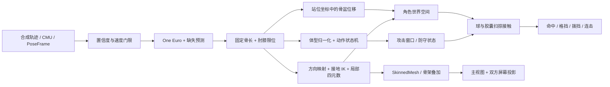

# Motion Lab v0.3：位移、攻防、实现与评估

本版本已完成一条能直接运行和检查的路径：输入关节点 → 稳定骨架 → 局部旋转与不同体型角色 → 位移、动作与空间攻防 → 三个视角。启动见 [README](../README.md)。这是一版供判断技术路线的工作原型，尚未完成真实相机条件下的验收。

## 实现在哪

| 文件 | 责任 |
| --- | --- |
| `src/dollfight/solver.py` | 逐帧、因果的可信观测筛选、平滑、缺失处理、骨长与关节约束 |
| `src/dollfight/kinematics.py` | 骨架树、3 种体型、双骨 IK、方向映射、局部旋转、接地 |
| `src/dollfight/recognition.py` | 基础事件、转体联合判定、时序组合、护架与拨挡 |
| `src/dollfight/locomotion.py` | 标定站位轴、米制位移映射、死区、限速、区域边界 |
| `src/dollfight/combat.py` / `duel.py` | 目标角色世界坐标、扫掠接触、有效攻击窗口与攻防裁决 |
| `src/dollfight/duel_fixture.py` | 35 秒两路独立合成关节流；不向判定器提供招式标签 |
| `src/dollfight/pipeline.py` | 输入适配、噪声实验、连续帧处理、可比较指标、协议导出 |
| `src/dollfight/server.py` | 仅本机的 HTTP 回放计算和静态界面 |
| `apps/motion-lab/avatar.js` | 程序生成模型、关节层级、绑定逆矩阵、加权顶点与蒙皮 |
| `apps/motion-lab/scene.js` / `projection.js` | 三个渲染视图、插值、物理屏幕与眼位投影 |
| `tools/convert_cmu.py` | 官方 ASF/AMC 的旋转链、单位和 canonical19 转换 |

渲染器每次请求先计算完整回放；随后逐帧播放。算法内部只读取当前/过去帧和预先标定的骨架，不把合成动作标签传入识别器。当前 HTTP 服务不是低延迟实时传输实现。

## 骨架与重定向的含金量

内部世界坐标为米制、Y 向上、人体初始朝 +Z、解剖学左侧为 +X。与相机的右手 optical 坐标分开；`PoseFrame` 外部协议保持 v0.1.0，不把浏览器回放 JSON 当作正式跨组协议。

骨架使用 19 个关节。参考骨长在整段内固定，缺失关节先在 150 ms 内做限速外推，随后回退到参考方向，并明确标记状态。外推用于连续显示，识别器只接受有效观测；失跟踪的肢体必须回到中立状态才能重新出招。

约束求解先从根到叶投影固定长度，再用解析双骨 IK 把肘、膝夹角限制在 18–177°。它是可解释的轻量基线，**不是全身带观测协方差的优化器**。根部观测误差会沿树传播；高噪声、长时间遮挡和快速动作仍会失真。

重定向保持目标角色的骨长，将人体测得的骨方向变成目标全局旋转，再转换为 `q_local = inverse(q_parent_global) * q_global`。输出为 xyzw 四元数，处理连续帧的正负号，渲染端做 slerp。针对三个目标比例，测试从输出局部旋转重新做 FK，验证能重建输出关节点且保持目标骨长。

接地逻辑依据脚踝高度和速度选择支撑脚，在世界中保持锚点，用双骨 IK 调整腿。快速移动、脚尖翻转和体型差异大时仍可能跳变；没有实现完整接触优化和惯性过渡。v0.3 将骨盆的水平位移送入独立的站位映射，渲染组节点应用一次场景位移，骨架根只保留高度，避免根位移被计算两次。IK 在源骨架空间求解；位移放大后仍会产生滑步，尚未在映射后的世界空间重求支撑脚约束。

模型是程序生成的轻量人形皮套，实际使用 SkinnedMesh、绑定骨骼和顶点权重。它适合观察变形，尚不是精细美术资产。仅靠这些关节点不能唯一恢复前臂轴向扭转、手指和独立头部朝向；当前使用父骨架方向先验。换成 FBX/glTF 人形资产时，还需处理 bind pose、骨骼映射、轴向和关节限位。

## 动作判定

原有 13 类为：左右直拳、左右勾拳、左右上勾拳、左右膝击、左右前踢、下蹲、左右闪避。依据身体局部空间中的前伸、侧移、抬高、速度与腿部夹角判定，长度/速度阈值按已标定的肢体尺度归一化。时间戳严格递增；转身不直接改变招式左右定义。

每条肢体维护就绪、准备、提交、回收、不可靠状态，带门限回滞和冷却。持续伸手不会逐帧产生攻击。`confidence` 目前是启发式分数，**不是校准后的分类概率**。

合成轨迹参与了阈值设计，因此 13 类通过属于回归验证，不能当作独立测试集准确率。CMU 真实拳击没有逐拳标注，事件只能人工检查。v0.3 另实现左右转身鞭拳/旋转踢、护架和三种时序组合。动作取消、轻重拳、前后手架势、斜向拳、扫踢、跳跃等仍需要独立定义与真实数据。

## 位移与攻防如何实现

**先缩短距离，再判断空间接触。** 位移轴使用初始化时的相机站位坐标：源 +Z 为前进、+X 为人体左侧。转体不翻转移动方向。骨盆位移经 2.5 cm 死区、65 ms 平滑、1.8 m/s 场景限速、可调 0.5–2.5 倍增益，映射到角色位置；有效源范围是前后 ±0.65 m、横向 ±0.45 m。骨盆失跟踪时保持位置。默认两人相隔 2.2 m，分别前进约 0.55 m 后进入近身区域；2.5D 站位保持左右顺序和至少 0.55 m 的 X 间距。

映射不是让玩家在现实中相互逼近：每人围绕自己的相机/屏幕站位小幅进退，虚拟空间由游戏层放大。这里的限幅是原型参数，不能代替真实安装时的活动范围标定。

识别器输出的是“提交了一次动作”，碰撞器才决定结果。拳以手腕球、踢以踝球、膝击以膝球表示；目标使用头、躯干、双大腿胶囊。基本拳/踢窗口分别为 0.32/0.40 s，旋转攻击为 0.85 s。两帧之间同时插值攻击者和目标，每约 2.5 cm 采样，最多 40 段，减轻快拳穿透；这仍是近似扫掠，极端速度/长间隔需连续碰撞或更高采样率。每次攻击最多结算一次；失跟踪取消，过期窗口不得继续扣血。受击或被拨挡会阻止硬直期内的新攻击并取消正在进行的攻击。当前同帧接触按攻击列表顺序处理，尚未实现交换命中和帧同步裁决。

**防守既看姿态，也看位置和时机。** 手腕相对肩的位置给出高位、中位、交叉、单臂护架；只有有效前臂胶囊与来袭拳脚相交、且身体朝向攻击者时才格挡。护头不能挡住没碰到前臂的躯干/腿部攻击。向外拨腕打开 220 ms 的拨挡窗口，每次只可消费一次；拨挡后 1.3 s 内命中标为反击。普通/旋转格挡消耗 15/23 点防守槽，耗尽可破防。它是可解释规则基线，还没有独立真人防守数据的误触发评估。

**旋转不能只看手脚速度。** 从肩与躯干估计航向，展开角度后累计有方向的转角，方向反转时重置，再联合抬腿、伸腿或抬起伸展的手臂判定；左右摇晃不会不断累加绝对转角。连续转角超过约 57° 才抑制普通拳，超过约 120° 再联合肢体证据发出旋转招式，不能仅凭转腰速度快就屏蔽出拳。测试覆盖快速 ±20° 转腰下的全部 13 类基础动作，以及旋转时丢失膝/肘的情况。单相机背身时关键关节可能消失，目前会取消证据不足的攻击，尚未解决 360° 跟踪。

**输入连招和命中连击分开。** 目前支持“左直→右直→左勾”“右直→左直→右上勾”“左直→右旋踢”，相邻提交间隔上限 0.95 s。组合只附在最后一次输入事件上，不额外扣血。连续实际命中间隔小于 1.1 s 才累计 HIT；挥空/格挡/拨挡会断连，输入组合完成也可能只算两次独立命中。这里尚未实现商业格斗游戏的取消帧、浮空追击和整套自动播放。

## 这次新增的可复现实验

`uv run --locked python tools/evaluate_duel.py` 对同一两路输入分别开启/关闭位移，并测试 0 / 5 mm 观测噪声。输入标签只负责生成骨架，不提供给识别和碰撞模块。结果写入 `outputs/duel-evaluation.json`，包含每次接触的伤害、部位、连击、拨挡反击和最近表面间隙。

| 对照 | 应观察的结果 |
| --- | --- |
| 默认双人对练 | 远距不扣血、靠近三连击、后撤/侧移挥空、两种格挡、拨挡反击、旋转攻击 |
| 同一输入关闭位移 | 双方停在 2.2 m 间距，整段保持 100 / 100 HP |
| 高位护架 + 躯干踢 | 没接触前臂的攻击仍命中；不能仅因识别到“防守”就免伤 |
| 旋转负样本 | 手臂垂下转身、左右晃动、躯干失跟踪均不得变成旋转攻击 |

2026-10-23 本机复现，seed=42，标准体型、默认映射。0 mm 与 5 mm 噪声都得到：9 次命中、2 次格挡、1 次拨挡、3 次挥空和 1 次距离外；最终 P1/P2 为 74/22 HP。相同输入关闭位移后，16 次攻击全部距离外、最终 100/100 HP。第一段逼近形成 3 HIT，最后“直拳→旋踢”完成输入组合但两次接触相隔超过 1.1 s，因此没有冒充命中连击。该记录仅用于此合成样本回归。

战术对练是两路独立的人工轨迹；其他单人输入保留延后 4.5 s 的镜像对练，不在结尾循环跳回。动作与血量都预先计算，向后拖动时间轴不会重复扣血。尚未接入两台 Gemini 的时钟同步与实时流，正式接入需复用逐帧模块并补时间对齐层。

## 两个玩家的眼睛视角

两个视窗观察同一个对战场景。设虚拟屏幕左下/右下/左上角为 a/b/c，从屏幕得到 right、up、normal；将眼位到角点的向量投影到这些轴，生成非对称视锥。屏幕固定，眼位移动时窗后的世界应改变透视，而屏幕角点仍落在 NDC 的 ±1 边界。

三个 Node 测试直接使用前端同一投影函数，验证双方屏幕在横向/纵向眼位移动下的角点不变性和无效眼位拒绝。界面允许关闭 off-axis 与普通 LookAt 对照。v0.3 的虚拟眼位随角色移动，物理眼位偏移单独由源头部相对初始站位计算，防止虚拟角色前进时穿过旧屏幕平面。屏幕宽度假设为 0.78 m、初始观看距离为 1.15 m，距离限制到 0.35–2 m；它们是演示值。实际安装需标定屏幕三角点、每人的站位轴与头眼偏移。没有屏幕标定，不能把它当作已经校准的真实窗口。

## 怎样评价这一版

| 操作 | 应检查什么 |
| --- | --- |
| 招式巡检，逐帧/慢放 | 准备、提交、回收是否合理；同一动作是否重复触发 |
| 原始/约束/蒙皮并排 | 骨长是否稳定、动作是否被拉偏、目标是否保留动作语义 |
| 改长臂或宽肩角色 | 手脚是否穿体、肘膝是否翻折、足底是否漂移 |
| 开关平滑与约束 | 抖动降低是否值得付出响应滞后；不能只比较“看起来更平滑” |
| 遮挡样例与随机缺失 | 是否明确失跟踪、是否误出招、恢复是否突然跳变 |
| 真实 CMU 回放 | 身体转向、脚步、快速连拳与可疑分类，优先检查这里的失败 |
| 两个眼位视窗 | 是否看到对手正面，移动眼位时有无正确的视差 |

默认噪声是各坐标轴独立高斯噪声的标准差，不是最终三维误差，所以 15 mm 噪声对应约 24 mm 的平均三维观测偏差。缺失是可控扰动，不是对真实 RGB-D 噪声分布的精确模拟。

界面原始/处理后偏差在**同一批有效观测关节**上，与未加噪的输入比较。报告另列全关节偏差与缺失关节偏差，避免平均数掩盖长遮挡。导入的数据没有独立真值，其指标只表示相对输入的一致性；不能解读为测量精度提高。

`processing_p95_ms` 只测单人的 Python 骨架、识别和重定向，不包含双方空间碰撞、相机、传输、排队、序列 JSON 编码或浏览器渲染。浏览器 FPS 也不是动作到画面的端到端延迟。

## v0.2 历史对照记录（保留基线）

2026-10-23，Python 3.10.19，Windows，seed=42；运行 `uv run --locked python tools/evaluate.py`。数值为四舍五入后的毫米，默认启用平滑/约束/接地。

| 输入/设置 | 原始偏差 → 处理后偏差 | 事件数 | 观察 |
| --- | --- | --- | --- |
| 无噪声合成巡检 | 0 → 3.66 | 13 | 平滑本身也有滞后 |
| 15 mm 噪声，关闭平滑与约束 | 24.02 → 24.02 | 13 | 未处理基线 |
| 15 mm 噪声，启用处理 | 24.02 → 13.39 | 13 | 骨长平均偏差 16.991 → 0 mm |
| 15 mm 噪声 + 15% 随机缺失 | 23.96 → 14.03 | 4 | 保守门控漏掉较多动作，需要改进可用性 |
| 局部持续遮挡 | 24.03 → 13.36 | 12 | 缺失关节自身偏差 323.82 mm，不能隐藏这个失败 |
| 静止负样本，30 mm 噪声 | 48.03 → 24.51 | 0 | 本段没有误出招；不等于任意负样本都通过 |
| 真实 CMU，无附加噪声 | 0 → 24.25 | 23 | 处理会改变真实运动，不能默认越平滑越准 |
| 真实 CMU，15 mm 噪声 | 24.04 → 27.17 | 23 | 当前默认设置在这段快动作上增加偏差 |

本次逐帧算法 P95 约 6.2–9.1 ms，桌面同时在渲染，不能推广为其他机器性能保证。完整结果由脚本写入忽略的 `outputs/evaluation.json`，包含配置、锁文件 hash、事件和适用限制。随机缺失实验的漏触发、长遮挡和 CMU 偏差是明确保留的改进点。

## 下一步该在哪做细

1. **先改观测约束，而不是先扩动作数量**：用置信度/深度不确定性加权关节点，关节角参数化配合局部窗口优化；与当前快速投影比较误差、延迟、骨长和脚滑。
2. **遮挡采用骨段方向与接触先验**：当前长遮挡回参考姿态太粗。改成维持上次可信姿态、受限预测及平滑重获；动作门控需要在误触发和漏触发间评估，不能简单全部放宽。
3. **用真实人员数据决定是否训练**：先录制带时序标签的拳、假动作、聊天摆手、转身和遮挡，按人划分训练/测试。比较规则/DTW/小型时序网络的事件 precision/recall、提交时延与重复触发，再决定是否租 GPU。
4. **美术皮套接入**：增加标准 glTF/FBX 人形和 bind pose 映射，验证前臂扭转、肩部、手部、脚底和自碰撞；接入 Unity 时复用数值回归和输入协议。

这些步骤可以用同一 Motion Lab 回放对照，避免不同算法各自挑一段演示。

## 跨组交付

采集方提供 `canonical19` 的单人连续 `PoseFrame` JSONL，即可从界面导入；正式实时接入后继续复用 `SkeletonSolver.process`、`ActionRecognizer.process`、`Retargeter.process`。导入当前只接受单一 stream/clock/calibration，拒绝乱序时间和混流，最多 1800 帧。起始约 30 帧用于站立骨长与身高标定。

当前导入适配假定相机水平，执行 `world = optical * [1,-1,-1] + [0,height,distance]`。任意安装姿态需在正式适配器中使用真实外参；不要直接把像素或任意 world 坐标标成 optical。导出的 demo PoseFrame 使用固定 h=1.4 m、d=2.5 m 的虚拟相机，schema v0.1.0。

浏览器返回的 `rotations/root/events` 为评估 API v0.3.0（新增 `duel`，内部试验字段可继续变化），尚未冒充正式 `AvatarPose/ActionEvent` 协议（事件字段不同）。与其他模块联调时增加显式适配层并一起更新 fixture；不要让另一组依赖实验界面的内部 JSON 字段。

新资产和算法在 feature 分支提交，附可重复输入、配置、改进前后指标、失败样例和实际截图。Python 依赖提交 uv.lock；真实个人录制不进 Git，公开小样本的来源和 hash 则随代码版本保存。
