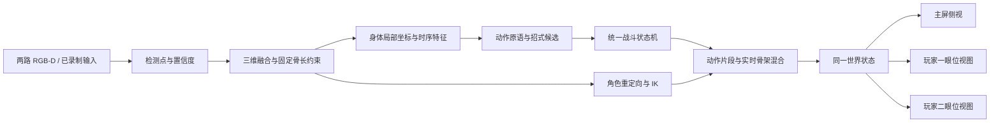

# 三维骨架、动作和渲染技术方案

状态：2026-10-23 研究与接口草案；引擎未定，硬件按 Gemini 系列暂定。以下是设计建议，除 README 标出的基础代码外均未实现。本文不指定成员分工或日历排期。

## 1. 我们这一部分的技术定位

建议把成果表述为：**面向 RGB-D 体感格斗的置信度感知人体运动重建、跨角色重定向与头部跟踪视角渲染**。

可量化的贡献在于：同一套带噪声的观测，经处理后骨长更稳定、遮挡恢复更可靠、不同身材角色动作更一致、招式误触发更少、屏幕视差更符合玩家的位置。游戏场景负责把这些效果展示出来。

严格区分四个对象：传感器观测点、人体运动学骨架、角色绑定骨架、格斗动画。观测点不等于模型骨骼；扫描出来的网格也不会自动获得可用骨骼与蒙皮。

每台相机主要看一个玩家。两台相机并不天然构成能融合每个人的双目系统；没有同时看到同一身体部位，就不能声称通过双视角消除了遮挡。两路输入应先独立校准、跟踪，再映射到共享虚拟舞台。

## 2. 从课程基础出发选择输入路线

本地 Lab3 的 `exercise/camera.py` 已有 OpenCV `CAP_OBSENSOR` 采集、深度毫米转米、内参读取；其演示文档记录 Gemini 2 曾完成真实设备验证。这支持先沿用已经工作过的设备路线，但不能证明所有 Gemini 型号和固件都兼容。Lab2 的 Astra 骨骼示例属于另一条 SDK 路线。

建议第一版采用 **RGB 人体关键点 + 对齐深度 + 人体约束**：

1. 采集组交付同步 RGB、深度、内外参、畸变、深度单位、帧时间与对齐模式。图像同尺寸不代表已几何对齐，必须做边缘/标定物验证。
2. MediaPipe Pose Landmarker 可作为轻量候选，使用其二维点和可见性，也保留估计三维点作遮挡先验。官方输出的 world landmarks 以髋部中点为原点；它不是房间坐标，也不是由你们深度相机实测出的绝对三维点。[官方说明](https://developers.google.com/edge/mediapipe/solutions/vision/pose_landmarker/python)
3. 2D 检测点映射到对应的已去畸变图像网格，在人体掩膜内选取附近可信深度；采用局部稳健统计和时间一致性门控。
4. 将深度观测、图像观测、单目先验和人体约束融合，而不是直接把每个像素的深度当成关节中心。

Orbbec 官方 SDK 和 Python wrapper 提供设备支持表、RGB-D 对齐及标定信息。具体使用 SDK v1、v2 还是课程 OpenCV 后端，要按实物型号/固件做短样本验证；没有确认前不升级设备固件，也不把 native DLL 当成普通 Python 依赖。[SDK 支持表](https://github.com/orbbec/OrbbecSDK_v2) · [Python wrapper](https://github.com/orbbec/pyorbbecsdk)

## 3. 三维恢复与骨架约束：主要算法贡献

对已去畸变的像素 `(u,v)`，相应光轴深度为 `z`：

\[
p_c=zK^{-1}[u,v,1]^T,
\qquad p_s=R_{s\leftarrow c}p_c+t_{s\leftarrow c}.
\]

这里 z 不是沿归一化视线的距离。若深度注册到 RGB 网格，须使用与该注册结果对应的内参和深度定义，不能混用原始 depth 内参与 RGB 像素。当前 `geometry.backproject` 只实现这个明确前提下的基础反投影。

**难点是观测不完整且会错。** 手腕挡在胸前时，邻域中位数可能选中胸部；侧身时一侧肢体会消失；衣服表面距离不等于解剖关节深度。应输出 observed / inferred / predicted / missing 状态；低置信度不能伪装为真实观测。左右手始终按解剖侧定义，自拍镜像只放在预览层。

建立固定拓扑的人体树，第一版统一 19 个观测节点，映射定义见接口文档。开始时用短时间自然站立或 A/T-pose 做个体校准，按可靠帧的稳健统计估计身体比例，冻结各段骨长。脊柱和颈部等虚拟节点须明确标为推断。

可先实现“稳健深度 + 1€ 滤波 + 骨长投影”，再与约束优化比较。1€ 的截止频率随速度调整，可调节静止抖动和快速动作滞后的平衡；参数取决于单位和实际轨迹，应在本项目数据上调节。[算法作者说明](https://gery.casiez.net/1euro/)

进一步使用根位姿 r、关节角 q 和校准骨长 l 表示 `FK(r,q,l)`，最小化：

\[
E=\sum_j w_j\rho(\|FK_j-p_j^{obs}\|^2)
 +\lambda_{2D}\sum_j\tilde w_j\rho(\|\pi(FK_j)-u_j\|^2)
 +\lambda_t E_{temporal}+\lambda_a E_{angle}+\lambda_f E_{foot}.
\]

`p_obs` 是经过校准/融合得到的关节代理观测。只有表面深度时，应使用沿视线的深度约束或带不确定区间的残差，不能声称它是真实关节中心。`E_angle` 限制肘膝等关节；脚底项只在可靠接地阶段启用。固定 l 通过 FK 直接保证骨长，不再靠不断缩放骨头追逐噪声。

先在不运行整个人体优化的情况下完成两段手臂/腿的解析 IK，之后只在约束残差大的局部求解。避免第一步就部署重型全身参数化人体拟合。断流时只短暂预测用于画面连续性，随预测时长降低可信度；持续丢失则回到待机且禁止产生攻击事件。

## 4. 人体骨架 → 角色骨架 → 蒙皮

每个角色交付一个 rig profile：单位、轴向、绑定姿态、骨骼层级、语义骨名、骨长、关节范围、根节点、网格与骨架的变换。先使用一个标准 humanoid 模型，让坐标和动作链路稳定，再接不同皮套。

重定向分四步：

1. 语义映射：left_elbow 对应哪条角色上臂链，pelvis 对应哪个 root/hips。观测点和角色骨骼不必一一对应；手指、锁骨和扭转骨可以由 rig profile 补全。
2. 用躯干建立身体基准，用骨段方向及肘膝平面建立局部姿态。两点只确定骨段方向，无法确定绕骨段的 twist；接近伸直时弯曲平面也退化，需连续性、解剖约束和次级参考。
3. 在统一坐标与对应的语义框架下，先求 `R_delta = R_source(t) R_source(rest)^T`，再作用于目标绑定朝向 `R_target_global = R_delta R_target_rest`；最后用父节点逆旋转求局部旋转。实际实现还要处理 rig 的额外轴偏置，不能把源关节世界旋转直接写成目标 localRotation。
4. 保持目标角色自己的骨长，按人体比例映射末端目标，再用手脚 IK、脚底锁定和关节限位修正。逐帧缩放整条骨链容易拉长手臂和造成脚滑。

旋转使用归一化四元数和最短弧插值，处理 q 与 -q 表示同一旋转的连续性。坐标基变换必须先按矩阵完成再转四元数。Unity 可利用 Humanoid Avatar、Animation Rigging 和 Two Bone IK；这些能力帮助消费重定向结果，但不替代我们对观测、骨架坐标与约束的设计。[Humanoid 重定向](https://docs.unity3d.com/6000.0/Documentation/Manual/Retargeting.html) · [Two Bone IK](https://docs.unity.cn/Packages/com.unity.animation.rigging%401.0/manual/constraints/TwoBoneIKConstraint.html)

线性蒙皮在统一模型坐标下可写为：

\[
v'=\sum_i w_i G_i(t)G_i(bind)^{-1}v,
\qquad\sum_iw_i=1.
\]

若引擎把网格节点变换分开存储，还需按其约定乘网格变换的逆。重点验证绑定姿态、权重和逆绑定矩阵一致；引擎负责 GPU 蒙皮，不必为课程从零重写渲染器。[Khronos 蒙皮教程](https://github.com/KhronosGroup/glTF-Tutorials/blob/main/gltfTutorial/gltfTutorial_020_Skins.md)

## 5. 招式丰富度：动作原语、参数与时序组合

识别使用真实骨架的身体局部特征，不能从已经播放的格斗动画反过来识别，否则会形成自触发。位置以 pelvis 为中心、肩宽/身高为尺度，同时保留有单位的深度速度供分析。特征包括肘膝角、手脚相对肩髋的位置、速度方向、身体倾斜、足部接地和置信度。

下面是候选动作设计，不是当前已能准确区分的类别数量：

| 原语族 | 可扩展参数 | 主要时序证据 | 容易混淆的负样本 |
|---|---|---|---|
| 直拳 | 左右 × 中高位，距离分档 | 手腕沿身体前向加速、肘伸展、回收 | 指向、伸懒腰、调整站姿 |
| 勾拳 | 左右 × 中高位 | 手腕横向弧线，肘角保持一定弯曲 | 普通挥手、转身 |
| 上勾拳 | 左右 | 手腕由低到高，配合肘肩轨迹 | 抬手防御 |
| 前踢 | 左右 × 低中位 | 抬膝、伸膝、脚踝前移、回收 | 迈步 |
| 侧踢 | 左右 × 低中位 | 髋外展、侧向伸腿、回收 | 侧移；视角依赖明显 |
| 膝击 | 左右 | 膝抬升而小腿仍明显弯曲 | 走路、前踢准备阶段 |
| 防御 | 高位、低位、交叉 | 双腕位置与躯干姿态持续稳定 | 拳击回收 |
| 闪避 | 左、右、后撤、下潜 | 头胸偏移，根位置与脚步辅助 | 摄像头抖动、自然摆动 |
| 移动 | 前进、后退、侧移 | 足部交替/重心变化 | 出拳时身体前倾 |
| 蓄力/释放 | 站姿与时长 | 稳定姿态后接特定释放动作 | 长时间抱臂 |
| 招架/反击 | 防御后特定窗口 | 防御事件 + 战斗状态 + 反击原语 | 单独抬手 |
| 连段/必杀 | 事件序列和时间窗 | 例如 左直拳→右直拳→膝击 | 未回收的同一拳被多算 |

可先设计几十种有效“输入变体”，但只开放实验中可分的组合，不能把笛卡尔积当识别性能。小幅手指动作、后背动作、旋转踢和腾空动作在当前单正面相机条件下不宜作为基础交互。

第一阶段采用 **带迟滞阈值的有限状态机 + 短序列模板/DTW**。例如直拳经过 guard → preparation → extension → committed → recovery，只有越过提交条件才发一次事件，恢复前不能再次发拳。不要只用一个 wrist_z 阈值；不确定样本归为 unknown。DTW 需用流式/子序列方案、时长约束和负样本阈值，否则等整段动作结束才分类会拖慢交互。

游戏层再按方向、高度、节奏、蓄力、资源、当前受击状态组合成招式。同一个直拳原语可以对应普通拳、前进拳、反击或连段收尾；角色拥有独立招式表。现实速度可映射有限等级，但不直接无限放大伤害。

有了规则基线与标注数据后，再比较轻量时序卷积/GRU/小型 ST-GCN。ST-GCN 建模关节图与时间关系，可作为研究对照；公开动作数据集的类别并不等于本项目拳招，因此不能拿预训练结果直接宣称可用。[原论文](https://arxiv.org/abs/1801.07455)

租 GPU 适合离线训练和调参；先以本地可导出的轻量模型为目标，训练完必须回到演示电脑测延迟。不要把逐帧姿态推理或格斗判定依赖公网服务器。

## 6. 实时跟随与拳皇动画怎样共存

待机、格挡、身体摆动采用实时重定向。攻击提交后按骨骼遮罩混入招式动画，使动作具有清晰的前摇、有效帧和后摇；结束时平滑回到当前真实姿态，低置信度部位降低实时权重。

招式动画、碰撞框、判定时刻和根位移由同一战斗状态机驱动。识别服务只提交动作候选，不能直接扣血。需要一个权威状态源统一血量、命中、击退与资源，两名玩家和观众画面读取同一状态。动作状态机的“有效帧”是游戏时间，不能直接等同于传感器帧号。

尽量采用 in-place 动画并由游戏层控制根运动，避免动捕位移、动画 root motion 与击退三者重复相加。手臂追踪仍可微调朝向，但攻击有效期内不能任由噪声改变判定体积。

## 7. 三个视角与“玩家眼睛视角”

主屏采用经典 2.5D 格斗构图，底层仍是 3D 场景。玩家一、二的屏幕分别从自己的虚拟眼位观察对手。同一世界、同一时间状态，只改变相机与显示遮罩；为节约算力先在一台主机上完成多视口，再视 USB 带宽和测量结果决定是否分机。

建议把玩家视图分两级实现：

- 基础：稳定的第一人称近似视角，用头部中心加校准偏移估计眼位，显示对手和自己的手臂。做近裁剪与自身体隐藏，控制摄像机抖动。
- 进阶：测量物理屏幕的位置和尺寸，根据眼位建立非对称视锥。玩家左右移动时，屏幕如同通往虚拟世界的窗口，产生正确的运动视差。

进阶方法需要屏幕与相机之间的外参。给定屏幕左下/右下/左上角 a、b、c，眼位 e，屏幕正交基 r、u、n，近裁剪距离 N：

\[
d=-n\cdot(a-e),\quad
l=N\frac{r\cdot(a-e)}d,\quad
r_f=N\frac{r\cdot(b-e)}d,\quad
b_f=N\frac{u\cdot(a-e)}d,\quad
t=N\frac{u\cdot(c-e)}d.
\]

应保证 d>0，屏幕角点经测量形成正交矩形，并同时设置与屏幕方向一致的 view matrix；不能只让普通对称 FOV 相机 LookAt 对手。实现还需适配引擎裁剪空间和矩阵约定。[Kooima：广义透视投影](https://kooima.net/site/pdfs/gen-perspective.pdf)

普通屏幕第一版采用双眼中点的单目透视；这提供头部运动视差，不会自动产生双眼立体视觉。头部姿态也不是精确眼球注视方向。对手自然面向玩家时可以看到正脸，但对手转身时强制其脸始终朝镜头，会与真实视角矛盾；应通过站位/角色朝向规则处理这一产品取舍。

## 8. 皮套与扫描的边界

最容易接入的是标准已绑定角色。美术/扫描侧交付网格、材质、骨架、权重、绑定姿态和 rig profile；我们负责验证、重定向和运行时驱动。

若要真人扫描皮套，流程是多视角采样/配准 → 网格重建 → 清理与重拓扑 → UV/纹理 → 骨架绑定与权重 → 极限姿态变形检查。单次正面 RGB-D 只有可见表面，不能恢复背面，也不能自动获得可稳定变形的完整人体；用正面照片贴脸不等于任意视角的真人面部重建。第一版可用通用身体加个性化头部纹理，完整扫描作为扩展。

## 9. 低配置下的运行策略

Python 负责视觉/数值处理和实验，渲染交给引擎。骨架更新初始目标 20–30 Hz，渲染尽量 60 Hz、资源紧张时先保证稳定 30 Hz；这些是待实测目标。推理使用人体 ROI/缩小输入，深度保留原分辨率采样；缓存只保留最新姿态，避免积压让玩家越打越延迟。

三路视图增加渲染成本，先用低面数角色、简单或烘焙环境光、有限实时阴影。识别不必每帧跑全身大模型。原始 RGB-D 本地录制，需要时离线处理；联机传骨架/事件/状态即可。

测量 capture → pose → solve → event → render 的分项耗时，分别报告运动到画面的延迟和动作到判定的延迟。可把姿态显示 P95 <120 ms 作为待验证起点，不能以高渲染 FPS 替代交互延迟。两台机器的 monotonic 时间不能直接相减；先做时钟映射，或用同一外部视频测量物理动作与屏幕响应。

## 10. 怎样证明课程含金量

| 实验 | 对比 | 要报告的指标 |
|---|---|---|
| 深度价值 | RGB 单目先验 / 深度直接采样 / 约束融合 | 重投影误差、可靠参考下的三维误差、有效深度比例 |
| 时序与约束 | 原始 / 平滑 / 平滑+固定骨长 / 再加 IK | 静止抖动、骨长变异系数、脚滑、恢复时间、延迟 |
| 跨角色迁移 | 相同动作驱动不同身材模型 | 末端偏差、关节越界、穿模案例与帧时 |
| 动作识别 | 阈值 / 状态机+DTW / 小模型 | 事件级 precision、recall、F1、每分钟误触发、漏发、提交延迟 |
| 视角 | 固定 / 普通头部相机 / 屏幕标定视锥 | 已知几何投影误差、相同眼位路径的视频对照 |

没有动捕真值时，骨长稳定不等于关节位置准确，重投影误差小也不等于深度正确；明确将它们称为一致性/代理指标，不虚报 MPJPE。可用尺寸已知的标定物检查几何，用重复姿势和少量独立标注检查人体结果。

识别数据必须包括休息、整理衣物、调整眼镜、慢动作、遮挡和动作间过渡等负样本。按人和完整采集场次划分训练/验证/测试，避免同一段视频相邻窗口跨集合。报告每类混淆矩阵，尤其观察直拳/勾拳、前踢/迈步、膝击/前踢起势。每个事件匹配一段人工标注时间区间，同一拳重复触发按额外假阳性计算。

答辩可提供同屏开关：RGB-D、原始骨架、约束骨架、角色绑定骨架、角色蒙皮、动作状态轨迹。记录 commit、uv.lock、相机固件、参数、数据清单和模型 hash，使某次误识别可以回放重现。

## 11. 按可验收闭环推进

1. 确认 RGB-D 标定与协议，保存一小段合法回放；没有设备时先用明确标记的合成样例开发。
2. 实现原始/约束骨架并排显示，完成一次举臂、直拳和遮挡恢复。
3. 驱动一个标准模型，解决左右镜像、骨骼轴、绑定姿态和脚底问题。
4. 接入一个有 recovery 状态的直拳事件，由战斗端确认后播放招式。
5. 打通同一场景的侧视、玩家一视角、玩家二视角，再实现屏幕标定。
6. 基于混淆矩阵扩展招式和皮套，最后决定哪些识别问题值得租 GPU 训练。

每一步都保留回放与对照结果。优先把几何、时序和接口做扎实，再增加类别数量。
