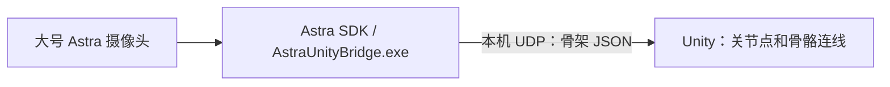

# Astra 人体骨架接入 Unity

已创建独立 Unity 工程，并完成本机骨架数据桥接。单摄像头场景显示一个人的骨架；双摄像头场景分别接收两台 Astra 的骨架，最多同时显示两人。每个骨架包括 19 个关节点和 18 条骨骼连线。识别由现有 Astra SDK 完成，Unity 接收并显示结果。

多人进入画面时，Unity 会持续跟踪当前选中的人，不会因为其他人出现而切换。当前人员丢失后，如果还有其他人被跟踪，会自动选择其中一人；没有人时则清空骨架。这里的单人限制作用于 Unity 接收与显示，Astra SDK 和发送端仍可能检测并传输多人的数据。

## 双 Astra、两个人

双摄像头场景将每路骨架分开显示在画面左右：每台摄像头各选取一人，两个接收器相互独立。请让两台摄像头尽量分别对准不同的人；系统目前不判断两路是否拍到了同一个人，也不融合两台相机的空间坐标。左右位置是 Unity 中人为设置的展示位置，不代表两人真实间距。

先测试模拟数据：

1. 双击 **`Open-Dual-Unity.cmd`**，打开双摄像头场景；在 Unity 顶部点击 **▶ Play**。
2. 双击 **`Run-Dual-Simulation.cmd`**，两个人体骨架将出现在画面两侧，动作略有区别。
3. 结束时关闭模拟发送窗口，点击 Unity 的 **▶** 退出运行。

使用两台真实摄像头时，先关闭所有模拟发送程序和其他摄像头 Viewer，连接两台大号 Astra，在双摄像头场景进入 Play 后，运行 **`Run-Dual-Live.cmd`**。发送器在同一进程打开 SDK 的 `device/sensor0` 和 `device/sensor1`，分别发送至本机端口 **7001** 和 **7002**。两个状态栏会分别显示各自的数据和跟踪人数；画面中的两个对象可分别移动、旋转以调整展示位置。

两台摄像头的编号对应哪一台，可能随连接顺序改变；重插后请重新核对。两路画面有重叠时可能会重复显示同一个人，深度相机相互干扰或 USB 带宽、电力不足也可能影响跟踪，需现场调整机位或接口。

**双摄像头状态：已通过两路模拟数据的 Unity 端到端测试；两台真实 Astra 同时读取骨架、设备兼容性、授权及帧率仍需接入设备后验证。** SDK 自带双设备示例证明了两路设备流的使用方式，但该示例并未验证两路人体骨架流。

## 先看模拟骨架

无需重新创建 Unity 工程，也无需接摄像头。

1. 双击本文件夹的 **`Open-Unity.cmd`**，打开已有的 `UnityProject` 工程和 `Demo` 场景。
2. 等 Unity 导入完成，点击顶部 **▶ Play**，在 **Game** 面板查看效果。
3. 双击 **`Run-Simulation.cmd`**。前两秒是 T 形站姿，之后双臂会不断抬起、放下。

模拟模式的状态栏显示 **`SIMULATED DATA`**，用于验证程序之间的连接。关闭发送窗口或按 Ctrl+C 停止发送；约一秒后 Unity 隐藏骨架。退出发送窗口后如果显示“按任意键继续”，按任意键关闭即可。

当前电脑已安装 Unity **6000.3.10f1**，打开入口使用该安装位置。如果入口找不到编辑器，在 Unity Hub 选择 **Add / 从磁盘添加项目**，选择本目录下的 **`UnityProject`** 文件夹。打开后双击 `Assets/AstraUnity/Demo.unity`，再按 Play。

## 换成真人骨架

1. 关闭模拟发送窗口、原来的 `SimpleBodyViewer-SFML` 和其他摄像头 Viewer。
2. 接入实验使用的**大号 Astra 摄像头**。目前接入的是 Astra SDK 2.1.3 的人体功能，小号 Gemini 不适用这条链路。
3. 保持 Unity 处于 Play 状态，双击 **`Run-Live.cmd`**。
4. 如果刚关闭模拟发送器，等待约一秒，让 Unity 切换到新的发送会话。
5. 面向摄像头，让全身进入视野。状态栏应显示 **`LIVE ASTRA`**，`Bodies` 大于 0，并能看到随动作变化的骨架。

已连接但没识别到人时，`Bodies: 0`，场景不显示骨架；SDK 不再提供帧时会进入等待状态。真实设备第一次接入时，需要核对左右方向、上下方向和人物所在画面位置。

**实机状态：本次启动真实数据发送器时，SDK 报告没有可用 Astra 摄像头。真人识别和方向、帧率仍待连接摄像头后验证。模拟演示不能替代这项验收。**

授权沿用原实验：如果 `../lab-env/astra-body-license.txt` 存在，真实数据入口自动读取；否则使用 SDK 内置试用。本项目未改变 SDK 的授权判断。SDK 官方说明的无有效授权人体试用时长为每次启动 30 分钟，见文末官方 API 文档。

## Unity 场景中的设置

选中 Hierarchy 中的 **Astra Skeleton**：

| 组件 / 字段 | 用途 |
|---|---|
| `AstraSkeletonReceiver` / `Port` | 默认 `7001`，须与发送器一致 |
| `Listen Address` | 默认 `127.0.0.1`，只接收本机数据 |
| `Timeout Seconds` | 默认 1 秒，超时后停止显示旧骨架 |
| `Mirror X` | 是否水平镜像显示，方便做镜子式交互 |
| `Axis Signs` | 各轴方向，默认 `(1,1,1)`；实机确认方向后再调整 |
| `AstraSkeletonView` / `Minimum Joint Status` | `1` 显示低置信度和正常关节；`2` 只显示正常跟踪关节 |
| `Joint Radius` / `Bone Width` | 关节点大小 / 骨骼连线粗细 |

Unity 中按 **1 单位 = 1 米** 显示，接收端自动把 SDK 的毫米坐标乘以 `0.001`。摄像头传感器坐标原点对应 `Astra Skeleton` 对象原点，可移动、旋转该对象改变骨架摆放位置。

`Demo` 使用正交相机，主要用于观察动作连通情况。若真人骨架超出画面，调整 Main Camera 的位置和 Orthographic Size。

## 文件与重新构建

| 文件 / 文件夹 | 用途 |
|---|---|
| `Open-Unity.cmd` | 打开已创建的工程和场景 |
| `Open-Dual-Unity.cmd` | 打开双摄像头演示场景 |
| `Run-Dual-Simulation.cmd` / `Run-Dual-Live.cmd` | 发送双路模拟 / 真实 Astra 骨架 |
| `Run-Simulation.cmd` | 发送模拟人体骨架 |
| `Run-Live.cmd` | 发送真实 Astra 人体骨架 |
| `Build-Bridge.cmd` | 用 VS2019、Release、x64 重新编译发送器并复制运行库 |
| `native/main.cpp` | SDK 读取、模拟数据和 UDP 发送 |
| `UnityProject/Assets/AstraUnity/Runtime` | 数据结构、接收组件、显示组件 |
| `UnityProject/Assets/AstraUnity/Demo.unity` | 已生成的演示场景 |
| `Verify-Bridge.ps1` | 启动 Unity、模拟发送器，执行联通验证后自动退出 |
| `logs/unity-self-test.json` | 自动验证结果 |
| `logs/unity-dual-self-test.json` | 双路模拟验证结果 |
| `logs/skeleton-preview.png` | 从 Unity 相机实际渲染的模拟骨架预览 |

当前发送器已生成在 `build/bin/Release/AstraUnityBridge.exe`，正常运行无需再编译。重新编译只影响本文件夹，原三套 SDK 的实验入口保持可用。

如果以后已有自己的 Unity 工程，将 `UnityProject/Assets/AstraUnity` 文件夹复制到该工程的 `Assets` 下即可；接收和显示不要求把 Astra 原生 DLL 放入 Unity。复制后可通过 **Tools → Astra Skeleton → Create Demo Scene** 创建演示场景（会先提示保存当前场景）。

## 数据接口（后续接模型时使用）

使用 UTF-8 JSON，经 IPv4 UDP 发送，每个数据报是一整帧。默认目标 `127.0.0.1:7001`。发送器不保存动作数据；接收端保留最新帧，避免积压造成动作延迟。

帧字段：

- `version`：协议版本，当前为 `1`。
- `session`：每次发送程序启动时生成的会话编号。
- `sequence`：发送帧编号，从 `0` 递增，用于过滤重复或乱序帧。
- `sourceFrame`：SDK 原始帧编号。
- `timestampMs`：发送器启动后经过的毫秒数，不是系统时间。
- `simulated`：是否为模拟数据。
- `units`：当前固定为 `mm`。
- `bodies`：UDP 原始数据中的人体数组最多包含 6 人。Unity 接收端会将 `LatestFrame.bodies` 和 `FrameReceived` 限制为最多 1 人；无人时为空数组。

每个人体包含 `id`、`status`、`joints`。关节包含 `type`、`status`、`position`（x/y/z 毫米）和 `orientation`（SDK 原始 3×3 矩阵，按行排列，9 个浮点数）。旋转矩阵暂不用于骨架显示，也没有转换成 Unity 四元数。

人体状态：`0` 未跟踪，`1` 丢失，`2` 开始跟踪，`3` 正在跟踪。关节状态：`0` 未跟踪，`1` 低置信度，`2` 正常跟踪。人体编号仅用于同一会话内持续跟踪，不能当作跨会话的身份编号。

关节编号按本地 SDK 的 `body_types.h` 定义：

| 编号 | 关节 | 编号 | 关节 |
|---:|---|---:|---|
| 0 | 头部 Head | 10 | 左髋 LeftHip |
| 1 | 肩部中点 ShoulderSpine | 11 | 左膝 LeftKnee |
| 2 | 左肩 LeftShoulder | 12 | 左脚 LeftFoot |
| 3 | 左肘 LeftElbow | 13 | 右髋 RightHip |
| 4 | 左手 LeftHand | 14 | 右膝 RightKnee |
| 5 | 右肩 RightShoulder | 15 | 右脚 RightFoot |
| 6 | 右肘 RightElbow | 16 | 左腕 LeftWrist |
| 7 | 右手 RightHand | 17 | 右腕 RightWrist |
| 8 | 脊柱中部 MidSpine | 18 | 颈部 Neck |
| 9 | 脊柱根部 BaseSpine | | |

扩展脚本可在主线程读取 `receiver.LatestFrame`、检查 `receiver.IsReceiving`，或订阅 `receiver.FrameReceived`。用 `receiver.ToWorldPosition(joint.position)` 获取换算和方向调整后的世界坐标。后续驱动 Humanoid 模型时，还需要模型骨骼映射和姿势校准，当前阶段只完成骨架显示。

发送器可选参数：`--dual`、`--simulate`、`--host IPv4地址`、`--port 端口`、`--frames 帧数`、`--license 授权文件`。双路模式的第二路使用指定端口加一。默认持续发送，模拟模式约 30 帧/秒，真实模式跟随各自 SDK 的输出频率。一个端口同一时间只使用一个发送器。

当前实现面向 **Windows 桌面版 Unity**；不支持 WebGL。跨电脑使用需将 Unity 的监听地址设为 `0.0.0.0`，发送器 `--host` 设为 Unity 电脑的 IPv4 地址；此时还需考虑网络、防火墙和 UDP 大包分片。先用默认本机链路完成实验。

## 已验证与尚待验证

- 原生发送器已编译成功，只有 SDK 头文件已有的匿名结构体警告。
- Unity 6000.3.10f1 脚本已实际导入、编译并运行。
- 已通过模拟发送器到 Unity 的端到端验证：持续接收、19 个关节、18 条连线、动作变化、单位转换、镜像、超时隐藏、恢复连接、重复和乱序过滤、非法 JSON、未跟踪关节隐藏、人体丢失和空帧，以及释放端口后重新监听。
- 已用 Unity 相机实际渲染模拟骨架并保存预览。
- 摄像头实机单人显示、人员切换、左右手映射和帧率仍需接入对应设备后验收；未实现人物模型驱动。

参考文档：[Astra SDK 2.1.3 官方 API](https://developer.orbbec.com.cn/technical_library/Astra_SDK2.1.3/html/md__d___desktop__a_io_t__s_d_k__doc__astra__s_d_k__doc__astra__s_d_k__doc_2_1_3_zh_0400__a_p_i.html)、[Unity JsonUtility.FromJson](https://docs.unity.cn/Documentation/ScriptReference/JsonUtility.FromJson.html)、[Microsoft UdpClient](https://learn.microsoft.com/en-us/dotnet/api/system.net.sockets.udpclient)。
